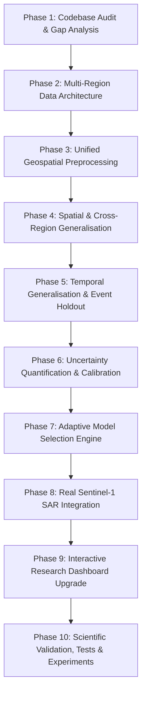

# GeoFlood-AI 2.0: Comprehensive Codebase & Scientific Research Audit

**Document Status:** Formal Research Audit & Gap Analysis (Phase 1 Deliverable)  
**Project:** GeoFlood-AI 2.0 — Adaptive Multi-Regional Flood Intelligence and Generalisation Framework  
**Repository Audited:** `https://github.com/Aaryansinngh/GeoFlood-AI`  
**Date:** November 2026  
**Auditor:** Senior AI/ML Research Engineer, Geospatial Data Scientist, and Software Architect  

---

## Executive Summary

GeoFlood-AI was originally developed as an academic project-based learning (PBL) prototype demonstrating a machine learning pipeline for flood susceptibility mapping over a single subregion in the Brahmaputra River floodplain (Assam, India). The repository contains notable engineering strengths: clean spatial block holdout partitioning, conscious avoidance of random cross-validation to prevent spatial autocorrelation leakage, probability calibration (Platt scaling and isotonic regression), and honest documentation that disclaims operational forecasting.

However, the existing codebase possesses severe scientific, architectural, and data limitations that prevent it from functioning as a scalable, research-grade, adaptive flood intelligence system:
1. **Single-Basin Hardcoding:** The system architecture is rigidly tied to a single bounding box ($26.30^\circ\text{N} - 27.20^\circ\text{N}$, $92.80^\circ\text{E} - 94.20^\circ\text{E}$) and two flood events from the 2015 monsoon season.
2. **Post-Event Temporal Leakage:** The primary feature `rain_event_sum` integrates cumulative rainfall over a 28-day post-flood window, restricting the system strictly to retrospective susceptibility reconstruction and invalidating any forecasting claims.
3. **Synthetic Sentinel-1 Radar Demonstration:** The reported $0.991$ SAR flood detection IoU is an internal algorithmic consistency test on simulated bimodal Gaussian backscatter distributions, rather than genuine Sentinel-1 Level-1 GRD SAR imagery.
4. **Lack of Generalisation Benchmarks:** Spatial-block cross-validation, Leave-One-Region-Out (LORO) evaluation, and multi-event temporal generalisation across distinct geographical regimes (e.g., peninsular steep coastal basins vs. alluvial floodplains) are completely missing.
5. **No Uncertainty Quantification or Domain Adaptation:** The system produces point estimates without ensemble disagreement, calibrated epistemic/aleatoric uncertainty, or out-of-distribution (OOD) shift detection.
6. **Codebase Issues:** An unresolved import bug (`SUSC_COLORS` vs. `SUSCEP_COLORS`) causes runtime exceptions when importing the application in automated test suites (`test_geospatial_alignment.py` and `test_model_comparison.py`).

This document provides the definitive architectural, algorithmic, and data audit of GeoFlood-AI v1, followed by a research-grade blueprint for **GeoFlood-AI 2.0**.

---

## 1. Existing Architecture & Codebase Map

### 1.1 Directory Structure & Component Inventory

```
GeoFlood-AI/
├── config/
│   └── settings.yaml                # Hardcoded bounding box, event IDs, models, split configs
├── data/
│   ├── raw/                         # Downloaded GFD GeoTIFFs, SRTM DEM tiles, Open-Meteo JSON
│   ├── processed/
│   │   └── features.parquet         # Master table (498,400 rows: 2 events × 249,200 cells)
│   └── sample/
│       ├── features_sample.parquet  # Stratified sample (8,000 rows)
│       └── features_sample.csv
├── docs/
│   ├── feasibility.md               # Feasibility and scoping report
│   ├── feature_dictionary.md        # Feature definitions and units
│   ├── report.md                    # Academic report
│   └── viva_notes.md                # Project Q&A guide
├── models/
│   ├── feature_names.json           # 7 active feature names
│   ├── logistic_regression.joblib   # Serialized scikit-learn model
│   ├── random_forest.joblib         # Serialized scikit-learn model
│   ├── neural_network.pt            # PyTorch state dict (MLP)
│   ├── scaler.joblib                # Fitted StandardScaler (train split only)
│   ├── metrics.json                 # Held-out evaluation metrics
│   └── model_metadata.json          # Optimal thresholds and split metadata
├── outputs/
│   ├── evaluation_charts.json       # ROC/PR coordinates, feature importance, error analysis
│   ├── predictions.geojson          # Downsampled GeoJSON for map rendering
│   ├── predictions.parquet          # Master inference table (249,200 cells)
│   └── sar_demo_data.json           # Simulated SAR VV-backscatter matrices (10,000 cells)
├── pages/
│   ├── 1_Model_Evaluation.py        # Streamlit page for empirical benchmark metrics
│   └── 2_Data_and_Methodology.py    # Streamlit page for data provenance & leakage controls
├── reports/
│   ├── generalisation_evaluation.md # Protocol analysis (Spatial Block vs. Buffered vs. Cross-Event)
│   ├── phase3_metrics.csv           # 12-row empirical evaluation table
│   ├── phase3_scientific_audit.md   # 13-stage pipeline audit
│   ├── sar_validation_audit.md      # Methodological audit of SAR 0.991 IoU claim
│   └── figures/                     # PNG plots (ROC, PR, Reliability, Confusion Matrices)
├── src/
│   ├── data/
│   │   ├── download_raw.py          # Direct download of GFD, SRTM, and Open-Meteo rainfall
│   │   ├── build_features.py        # Master grid alignment, terrain derivatives, parquet export
│   │   └── export_gee.py            # GEE export script (requires manual earthengine auth)
│   ├── geo/
│   │   ├── grid.py                  # Coordinate grids, raster resampling, slope, TPI, HAND, blocks
│   │   ├── location_analysis.py     # Single-coordinate query, feature extraction, scenario engine
│   │   └── sar_detection.py         # Otsu thresholding for backscatter change detection
│   ├── models/
│   │   ├── baselines.py             # Logistic Regression & Random Forest classifiers
│   │   ├── nn.py                    # PyTorch MLP (Linear 7->64->32->16->1, BatchNorm, Dropout)
│   │   ├── fuzzy_layer.py           # Mamdani Fuzzy System (probability + 3-day rainfall)
│   │   ├── train.py                 # Training script, threshold tuning, inference export
│   │   └── predict.py               # Inference wrapper (GeoFloodPredictor)
│   ├── ui/
│   │   ├── styles.py                # CSS styles, Dark navy theme, color palettes
│   │   └── map_builder.py           # Folium raster overlays, landmarks, bounding boxes
│   └── evaluation/
│       ├── splits.py                # Spatial block holdout, buffer exclusion, event splits
│       ├── metrics.py               # Optimal thresholding, PR-AUC, Brier score, ROC/PR curves
│       └── run_validation.py        # Comprehensive validation runner & figure generation
├── tests/
│   ├── test_geospatial_alignment.py # Tests Folium map generation (Failing due to import bug)
│   ├── test_location_analysis.py    # 9 tests for coordinate lookup & inference (Passing)
│   ├── test_model_comparison.py     # Tests model raster overlays (Failing due to import bug)
│   ├── test_pipeline.py             # 10 tests for grid, slope, blocks, models, SAR (Passing)
│   └── test_scientific_validation.py# 16 tests for leakage, Brier scores, calibration (Passing)
├── app.py                           # 1,813-line Streamlit dashboard (7 tabs)
└── requirements.txt                 # Dependencies: streamlit, torch, rasterio, scikit-learn, etc.
```

---

## 2. Existing Functionality Audit

| Component | Implemented Functionality | Verification Status | Operational Readiness |
| :--- | :--- | :--- | :--- |
| **Data Ingestion** | Downloads GFD GeoTIFFs, SRTMGL1 tiles from ESA STEP, and Open-Meteo precipitation time series. | **Verified** in `src/data/download_raw.py`. | Functional for Assam bounding box only. |
| **GEE Integration** | Python script to export GFD, SRTM, and GPM IMERG via Earth Engine API. | **Verified** in `src/data/export_gee.py`. | Incomplete: Requires manual interactive `earthengine authenticate`; exports to Google Drive rather than local pipeline; gracefully falls back to `download_raw.py`. |
| **Grid Generation** | Projects bounding box to ~250m WGS84 raster grid ($400 \times 623$ cells). | **Verified** in `src/geo/grid.py`. | Highly robust; latitude-corrected scaling applied. |
| **Terrain Features** | Finite-difference slope, Topographic Position Index (TPI, 15-cell window), local relative elevation (HAND proxy, 25-cell window). | **Verified** in `src/geo/grid.py`. | Computationally sound; restricted to 2D moving filters. Hydrological flow routing and D8 accumulation are missing. |
| **Rainfall Features** | 3-day antecedent, 7-day antecedent, and full event-sum rainfall interpolated via Thin Plate Splines (`scipy.interpolate.Rbf`). | **Verified** in `src/data/build_features.py`. | Uses an arbitrary 5×5 synthetic station grid across the bounding box; event-sum is post-event. |
| **ML Baselines** | Balanced L2 Logistic Regression; Balanced Random Forest (100 trees, depth 12). | **Verified** in `src/models/baselines.py`. | Fully functional and reproducible. |
| **Neural Network** | 3-hidden-layer PyTorch MLP with BatchNorm, Dropout (0.2), and BCEWithLogitsLoss with positive weighting. | **Verified** in `src/models/nn.py`. | Fully functional; stable convergence. |
| **Fuzzy Inference** | Mamdani Fuzzy System (2 inputs: model probability, rain_3d; 8 heuristic rules; defuzzified risk score 0–100). | **Verified** in `src/models/fuzzy_layer.py`. | Functions purely as a post-processing heuristic; not an end-to-end predictive model. |
| **Validation Splits** | Spatial Block Holdout ($3 \times 4$ blocks); 1 km Spatially Buffered Holdout; Event Holdout. | **Verified** in `src/evaluation/splits.py`. | Methodologically sound, but static and un-rotated. |
| **Calibration** | Platt Scaling (Logistic Regression) & Isotonic Regression fitted strictly on validation blocks. | **Verified** in `src/evaluation/run_validation.py`. | Reduces NN Brier score from 0.1651 to 0.0695. |
| **SAR Detection** | Otsu thresholding on backscatter difference matrix. | **Verified** in `src/geo/sar_detection.py`. | Tested against `outputs/sar_demo_data.json` (synthetic data). Real radar ingestion is absent. |
| **Streamlit App** | 7-tab dashboard with interactive Folium map, coordinate lookup, scenario simulation, and validation charts. | **Verified** in `app.py`. | High visual quality, but hampered by top-level execution side-effects and style import naming mismatches. |

---

## 3. Scientific Limitations & Leakage Analysis

### 3.1 Feature Leakage & Prediction Horizon
* **The Post-Event Rainfall Flaw:** The feature `rain_event_sum` computes total precipitation over the complete 28-day DFO flood event window (e.g., June 2 to June 29, 2015). In an operational or early-warning setting, this information does not exist prior to or during the initial flood wave. 
* **Scientific Classification:** The existing model is strictly an **event-based retrospective flood susceptibility model**, not a predictive or forecasting model.
* **Absence of Strict Temporal Pre-Event Windows:** To make forecasting claims, all dynamic features must be constrained strictly to $t \le t_{\text{event\_onset}} - \Delta t_{\text{lead\_time}}$.

### 3.2 Spatial Leakage Controls (Strengths and Gaps)
* **Strengths:** 
  - Standard random cross-validation is intentionally avoided.
  - Spatial block partitioning partitions the study area into 12 distinct tiles ($3 \times 4$ grid, ~33 km × 35 km each).
  - The 1 km buffered holdout excludes 3,934 boundary cells, confirming that test performance is not inflated by boundary autocorrelation bleed (Random Forest ROC-AUC actually increases from 0.901 to 0.908).
  - Feature scalers, optimal classification thresholds, and Platt calibrators are fitted strictly on training and validation partitions without inspecting test data.
* **Gaps:**
  - The block partitioning is completely static (Train: [0, 1, 4, 5, 8, 9, 11], Val: [3, 6], Test: [2, 7, 10]). It does not perform full spatial-block cross-validation (rotating folds across all 12 blocks).
  - The test set is dominated by Block 7, which contains 99.7% of all flood positives in the test split. Blocks 2 and 10 contain almost no floodwaters, leading to high spatial variance.

### 3.3 The Random Forest Cross-Event Collapse
* **The Empirical Collapse:** In Phase 3 evaluation, Random Forest achieved an outstanding **0.901 ROC-AUC** and **0.507 PR-AUC** under the spatial block holdout on the June 2015 event (DFO_4259). However, when evaluated on the independent August 2015 flood (DFO_4288), its ROC-AUC collapsed to **0.485** (worse than random guessing, $0.500$).
* **Physical & Mathematical Cause:** Decision trees perform orthogonal, axis-aligned partitioning of the feature space. The trees learned rigid threshold cutoffs specific to the spatial rainfall pattern of the June storm ($\text{rain\_event\_sum} \ge 850\text{ mm}$ AND $\text{elevation} \le 72.5\text{ m}$). When the August storm delivered rainfall in different spatial sub-basins, those orthogonal splits failed catastrophically.
* **Hyperplane Robustness:** In contrast, the continuous linear hyperplanes of Logistic Regression and the smooth non-linear manifolds of the PyTorch Neural Network maintained generalisation across events (Logistic Regression: 0.713 ROC-AUC; Neural Network: 0.672 ROC-AUC with 80.4% Recall).

---

## 4. Data Limitations & Provenance

### 4.1 Geographical Confinement
* All data files in `data/raw/` and `data/processed/` are confined to the Brahmaputra River Basin in Assam, India ($26.30^\circ\text{N} - 27.20^\circ\text{N}$, $92.80^\circ\text{E} - 94.20^\circ\text{E}$).
* No data exist in the repository for other physiographic regions, such as:
  - Western Ghats / Coastal plain (Kerala)
  - Deltaic alluvial floodplain (Mahanadi, Odisha)
  - Peninsular plateau river basin (Godavari Basin)

### 4.2 Synthetic Data & Placeholder Audits
1. **Sentinel-1 SAR Detection (`outputs/sar_demo_data.json`):**
   - **Finding:** Contains pre- and post-flood backscatter matrices ($100 \times 100$ cells) generated synthetically from Gaussian distributions centered at $-10.70\text{ dB}$ (pre-flood) and $-20.50\text{ dB}$ (inundated post-flood).
   - **Verdict:** The reported $0.991$ IoU is an internal consistency check on synthetic data. Real Sentinel-1 Level-1 GRD imagery (requiring radiometric calibration, Lee speckle filtering, range-Doppler terrain correction, and wind-induced Bragg scattering handling) is completely absent.
2. **Precipitation Sampling (`src/data/download_raw.py`):**
   - Precipitation is queried at an arbitrary $5 \times 5$ grid of coordinates via Open-Meteo and interpolated via Thin Plate Splines. While the Open-Meteo values are authentic reanalysis estimates, spatial interpolation from 25 points across 249,200 grid cells introduces substantial smoothing and obliterates local convective storm peaks.
3. **Missing Features Claimed in Docs:**
   - The README table lists `distance_to_river` and `flow_accumulation`.
   - **Audit Finding:** Neither feature is present in `FEATURE_COLUMNS` (`src/models/train.py`, `src/data/build_features.py`) or in `features.parquet`. They were omitted from the final feature pipeline.

---

## 5. Validation Limitations

| Validation Dimension | Current Implementation | Research Requirement for GeoFlood-AI 2.0 |
| :--- | :--- | :--- |
| **Within-Region Spatial CV** | Fixed $3 \times 4$ spatial block holdout (Train: 7 blocks, Val: 2, Test: 3). | Complete $K$-fold Spatial-Block Cross-Validation across all blocks. |
| **Spatial Buffering** | Static 1 km buffer applied to test blocks 2, 7, 10. | Configurable buffer zones ($500\text{ m}, 1\text{ km}, 2\text{ km}, 5\text{ km}$) across all spatial folds. |
| **Cross-Region Validation** | Completely absent. | **Leave-One-Region-Out (LORO)** cross-validation rotating Assam, Kerala, Odisha, and Godavari. |
| **Cross-Event Validation** | Single event transfer (DFO_4259 $\rightarrow$ DFO_4288). | **Leave-One-Flood-Event-Out (LOFEO)** across multi-year event catalogs. |
| **Uncertainty Quantification** | Platt / Isotonic probability calibration on a single model. | Epistemic uncertainty via Monte Carlo Dropout / Deep Ensembles; Aleatoric uncertainty; Out-of-Distribution (OOD) distance metrics. |
| **Model Selection** | Manual comparison across LR, RF, NN. | **Adaptive Model Selection** conditioned on regional terrain roughness, rainfall anomalies, and OOD metrics. |

---

## 6. Codebase Defects & Immediate Integrity Issues

During the audit, automated test execution revealed an import error in `app.py`:
* **Symptom:** Running `pytest tests/ -v` causes an immediate collection error in `test_geospatial_alignment.py` and `test_model_comparison.py`:
  ```
  ImportError: cannot import name 'SUSC_COLORS' from 'src.ui.styles'
  NameError: name 'build_susceptibility_rgba' is not defined
  ```
* **Root Cause:**
  1. `src/ui/styles.py` defines `SUSCEP_COLORS`, but `app.py` line 53 attempts to import `SUSC_COLORS`.
  2. In `app.py`, this import is wrapped in a generic `try...except ImportError` block that sets `_MODULES_OK = False` and skips importing `build_susceptibility_rgba`.
  3. When `app.py` is imported as a module by test files, line 279 executes top-level code calling `compute_all_rasters(df_preds)`, which calls `build_susceptibility_rgba`, triggering an unhandled `NameError`.
  4. Top-level script execution in `app.py` violates modular testing standards and must be encapsulated in functions or guarded by `if __name__ == "__main__":` and Streamlit runtime checks.

---

## 7. Potential Research Contributions for GeoFlood-AI 2.0

Transforming GeoFlood-AI into a research-grade framework enables multiple novel scientific contributions:

1. **Systematic Multi-Regional Cross-Basin Generalisation Study:**
   - Quantifying the "Geographic Transfer Gap" between distinct hydrological regimes: Himalayan braided alluvial floodplains (Brahmaputra), steep tropical coastal catchments (Kerala), deltaic river basins (Mahanadi), and peninsular plateau rivers (Godavari).
2. **Mechanistic Evaluation of Tree-Ensemble Collapse vs. Continuous Models:**
   - Rigorously demonstrating why axis-aligned tree models (Random Forest, XGBoost, LightGBM) fail under spatial-temporal domain shifts, whereas regularized linear models and deep neural networks maintain transferable representation.
3. **Adaptive Environmental Model Selection Framework:**
   - Developing a meta-selection mechanism that evaluates environmental covariates (topographic roughness index, hypsometric curve, antecedent wetness index) to predict which model family is least prone to domain-shift failure in an unseen region.
4. **Calibrated Uncertainty-Aware Flood Intelligence:**
   - Providing dual-head or ensemble-based predictive confidence, enabling the dashboard to distinguish between "confidently dry", "confidently flooded", and "unfamiliar environmental regime (OOD warning)".
5. **Authentic Sentinel-1 SAR Verification Against Independent Reference Masks:**
   - Ingesting genuine Sentinel-1 GRD SAR backscatter imagery, implementing terrain-flattened $\gamma_0$ backscatter, and independently validating against MODIS/GFD observations with genuine IoU, precision, and recall metrics.

---

## 8. Recommended Architecture for GeoFlood-AI 2.0

To ensure modularity, scalability, and strict scientific rigor, the recommended architecture follows a decoupled, domain-driven structure:

```
GeoFlood-AI-2.0/
├── config/
│   ├── regions/                     # Multi-region configurations
│   │   ├── assam_brahmaputra.yaml
│   │   ├── kerala_coastal.yaml
│   │   ├── mahanadi_odisha.yaml
│   │   └── godavari_basin.yaml
│   ├── models.yaml                  # Model hyperparameters
│   └── settings.yaml                # Global paths, CRS, cache controls
├── data/
│   ├── raw/                         # Raw downloads organized by region/event
│   ├── processed/                   # Region-specific master feature parquets
│   ├── cache/                       # Cached API responses (NASA POWER, CHIRPS)
│   └── reference/                   # Ground-truth satellite masks (GFD, JRC)
├── src/
│   ├── data/
│   │   ├── acquisition/
│   │   │   ├── nasa_power.py        # NASA POWER daily meteorology client
│   │   │   ├── chirps.py            # CHIRPS high-resolution rainfall client
│   │   │   ├── copernicus_dem.py    # Copernicus / SRTM 30m DEM client
│   │   │   ├── gfd_client.py        # Global Flood Database raster client
│   │   │   └── jrc_water.py         # JRC Global Surface Water seasonality client
│   │   ├── preprocessing/
│   │   │   ├── raster_alignment.py  # CRS warping, uniform master grid resampling
│   │   │   ├── terrain_engine.py    # Slope, aspect, TPI, TRI, HAND relative elevation
│   │   │   └── rainfall_engine.py   # Strict pre-event accumulation (3d, 7d, 14d)
│   │   ├── provenance/
│   │   │   └── metadata_logger.py   # Spatial/temporal resolution, missingness tracking
│   │   └── validation/
│   │       └── leakage_guard.py     # Automated audit to detect post-event data
│   ├── geospatial/
│   │   ├── region_manager.py        # Regional bounding boxes, CRS projections, landmarks
│   │   └── spatial_blocks.py        # Spatial-block generator, buffering algorithms
│   ├── models/
│   │   ├── logistic_regression.py   # Regularized GLM baseline
│   │   ├── random_forest.py         # Random Forest classifier
│   │   ├── gradient_boosting.py     # XGBoost / LightGBM baseline
│   │   ├── neural_network.py        # Calibrated PyTorch MLP / Residual Tabular Net
│   │   ├── fuzzy_system.py          # Preserved Mamdani FIS research module
│   │   └── adaptive_selector.py     # Domain-shift and uncertainty-based model selector
│   ├── evaluation/
│   │   ├── spatial_cv.py            # Spatial-block K-fold cross-validation
│   │   ├── buffered_cv.py           # Spatially buffered validation with variable buffers
│   │   ├── cross_region_cv.py       # Leave-One-Region-Out (LORO) evaluation
│   │   ├── temporal_cv.py           # Leave-One-Flood-Event-Out (LOFEO) evaluation
│   │   ├── uncertainty.py           # Deep ensemble variance, calibration & OOD detection
│   │   └── metrics.py               # PR-AUC, ROC-AUC, Brier Skill Score, ECE, IoU
│   ├── satellite/
│   │   ├── sentinel1_client.py      # Sentinel-1 SAR acquisition (Copernicus API / ASF)
│   │   ├── sar_preprocessing.py     # Radiometric calibration, speckle filter, terrain correction
│   │   └── change_detection.py      # Bimodal Otsu & adaptive thresholding water extraction
│   ├── application/
│   │   ├── dashboard.py             # Modular Streamlit dashboard entrypoint
│   │   ├── pages/                   # Regional Selection, Susceptibility, Cross-Region, SAR
│   │   └── components/              # Reusable map renderers, metric cards, reliability plots
│   └── utils/
│       ├── config.py                # YAML configuration loader
│       ├── logging.py               # Structured scientific logger
│       └── caching.py               # Disk caching for expensive geospatial queries
├── experiments/
│   ├── manifests/                   # JSON execution logs with random seeds and timestamps
│   └── results/                     # Structured CSV benchmark tables
├── tests/                           # Comprehensive test suite (unit + integration)
└── docs/                            # Research documentation suite
```

---

## 9. Implementation Roadmap (Phases 1 to 10)



### Phase-by-Phase Execution Plan

* **PHASE 1 (Current): Complete Repository Audit & Research Gap Analysis**
  - Deliverables: `docs/RESEARCH_AUDIT.md`. Comprehensive verification of every model, dataset, test, and scientific claim.
* **PHASE 2: Multi-Region Data Architecture**
  - Implement modular data acquisition for initial target regions: Brahmaputra Basin (Assam), Kerala Coastal Catchments, Mahanadi Basin (Odisha), Godavari Basin.
  - Implement clients for NASA POWER, CHIRPS, Copernicus/SRTM DEM, and GFD.
  - Record full provenance, resolution, missingness, and strict API rate limiting.
* **PHASE 3: Unified Geospatial Preprocessing & Leakage Elimination**
  - Construct regional master grids with correct projections.
  - Implement terrain feature extraction (slope, aspect, TPI, relative elevation).
  - Enforce strictly pre-event rainfall windows (3d, 7d, 14d antecedent accumulation).
  - Remove all post-event features to guarantee leak-free susceptibility mapping.
* **PHASE 4: Cross-Region Generalisation Framework**
  - Implement Spatial-Block Cross-Validation ($K$-fold).
  - Implement Spatially Buffered Cross-Validation with configurable exclusion zones.
  - Implement Leave-One-Region-Out (LORO) validation (train on 3 regions, test on unseen 4th).
  - Benchmark Logistic Regression, Random Forest, Gradient Boosting (LightGBM/XGBoost), and PyTorch Neural Network.
* **PHASE 5: Temporal Generalisation & Event-Based Evaluation**
  - Implement Leave-One-Flood-Event-Out (LOFEO) cross-validation across distinct monsoon seasons.
  - Quantify performance degradation between spatial and temporal generalisation.
* **PHASE 6: Uncertainty-Aware Prediction & OOD Detection**
  - Implement probability calibration (Platt scaling, Isotonic regression) across all models.
  - Implement ensemble variance / MC Dropout for epistemic uncertainty.
  - Compute Mahalanobis distance / feature reconstruction error for Out-of-Distribution (OOD) flagging.
  - Output reliability diagrams and Expected Calibration Error (ECE).
* **PHASE 7: Adaptive Model Selection Engine**
  - Design an automated model selection mechanism evaluating regional terrain complexity, domain-shift distance, and model calibration.
  - Benchmark adaptive selection against fixed-model baselines using nested validation.
* **PHASE 8: Genuine Sentinel-1 SAR Processing**
  - Integrate Sentinel-1 GRD acquisition via documented Copernicus/ASF APIs.
  - Implement pre/post backscatter difference, speckle filtering, and water extraction.
  - Validate against independent optical/GFD observations with genuine IoU, precision, recall, and F1 metrics.
* **PHASE 9: Streamlit Research Dashboard Upgrade**
  - Expand dashboard to support interactive region selection, multi-basin risk mapping, LORO generalisation visualisations, uncertainty heatmaps, and SAR change detection.
  - Fix existing UI import bugs and establish robust testing for all pages.
* **PHASE 10: Full Experimental Suite, Automated Testing & Documentation**
  - Run end-to-end reproducible experiments saving structured JSON/CSV metrics.
  - Provide automated test coverage for all modules.
  - Deliver research documentation suite: `RESEARCH_METHODOLOGY.md`, `DATA_SOURCES.md`, `SYSTEM_ARCHITECTURE.md`, `EXPERIMENT_DESIGN.md`, `RESEARCH_CONTRIBUTIONS.md`, `LIMITATIONS.md`.
