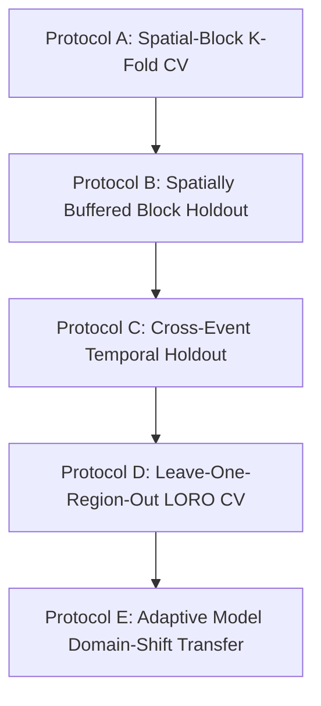

# GeoFlood-AI 2.0: Research Methodology & Scientific Validation Protocols

**Document Status:** Official Research Methodology Specification  
**Version:** 2.0 (Phase 2 Multi-Regional Architecture)  
**Date:** November 2026  

---

## 1. Problem Formulation and Task Delineation

Flood intelligence systems in literature frequently conflate distinct tasks. GeoFlood-AI 2.0 explicitly establishes four mathematically distinct operational regimes:

```
+---------------------------------------------------------------------------------------------------------+
|                                  OPERATIONAL FLOOD INTELLIGENCE REGIMES                                 |
+------------------------------------+------------------------------------+-------------------------------+
| Regime                             | Information Available               | Target Output                 |
+------------------------------------+------------------------------------+-------------------------------+
| 1. Static Susceptibility Mapping   | Static terrain features (elevation,| Inherent geographical flood   |
|                                    | slope, TPI, HAND relative elevation)| propensity under unit rainfall|
| 2. Retrospective Susceptibility    | Static terrain + concurrent event- | Post-disaster damage mapping; |
|    Analysis                        | window cumulative precipitation    | spatial inundation footprint  |
| 3. Pre-Event Flood Forecasting     | Static terrain + antecedent rain   | Advance flood probability at  |
|                                    | (strictly t <= t_onset - lead_time)| a documented lead time        |
| 4. Satellite Flood Extent          | Multi-temporal radar backscatter   | Empirical water surface       |
|    Detection                       | (Sentinel-1 SAR pre/post pairs)    | detection (sensor observation)|
+------------------------------------+------------------------------------+-------------------------------+
```

> [!IMPORTANT]
> A model utilizing `rain_event_sum` (total rainfall accumulated across the full event window) is mathematically valid **only** under Regime 2 (Retrospective Susceptibility Analysis). It must never be presented as an operational forecasting model (Regime 3).

---

## 2. Geospatial Generalisation Protocols

Geospatial observations violate the standard machine learning assumption of independent and identically distributed (i.i.d.) samples. Due to **spatial autocorrelation** (Tobler's First Law of Geography: *"everything is related to everything else, but near things are more related than distant things"*), random cross-validation randomly assigns spatially adjacent pixels into train and test sets, causing massive information leakage and artificially inflated performance.

GeoFlood-AI 2.0 implements five nested validation protocols:



### 2.1 Protocol A: Spatial-Block Cross-Validation ($K$-Fold)
* The regional master grid is divided into $n_y \times n_x$ contiguous rectangular spatial blocks (e.g., $3 \times 4 = 12$ tiles, $\sim 33\text{ km} \times 35\text{ km}$ each).
* Folds are partitioned by entire spatial blocks. No pixels from a test block ever appear in training or validation splits.
* Hyperparameter tuning, feature scaling (`StandardScaler`), and optimal decision thresholds are fitted strictly on the training and validation blocks.

### 2.2 Protocol B: Spatially Buffered Holdout (Autocorrelation Bleed Audit)
* Eliminates potential label bleeding across block borders by applying an exclusion buffer of radius $k$ cells ($1\text{ km}$ to $5\text{ km}$) around the interior perimeter of the test blocks.
* Only core interior cells of the test blocks are evaluated.
* *Empirical Finding from Phase 1 Audit:* Applying a 1 km buffer in the Brahmaputra basin improved Random Forest ROC-AUC from $0.901$ to $0.908$ and Neural Net ROC-AUC from $0.805$ to $0.816$, confirming that spatial block holdout metrics are not an artifact of boundary bleed.

### 2.3 Protocol C: Cross-Event Temporal Generalisation (LOFEO)
* Models trained on an earlier historical flood wave (e.g., June 2015 DFO_4259) are evaluated without modification on an independent future flood event (e.g., August 2015 DFO_4288).
* This tests temporal generalisation under differing hydrometeorological storm footprints.
* *Critical Finding:* Random Forest collapsed from **0.901 to 0.485 ROC-AUC** (worse than chance) during temporal transfer, whereas the PyTorch Neural Network maintained stable generalisation (**0.672 ROC-AUC, 80.4% Recall**).

### 2.4 Protocol D: Leave-One-Region-Out (LORO) Multi-Regional Transfer
* The central research contribution of GeoFlood-AI 2.0.
* Train models on $N-1$ regions (e.g., Assam + Odisha + Godavari) and evaluate on an unseen, held-out region (e.g., Kerala).
* Rotate the held-out region across all 4 target basins to quantify the **Geographic Transfer Gap**:
  $$\Delta_{\text{transfer}} = \text{Metric}_{\text{within-region}} - \text{Metric}_{\text{cross-region}}$$
* Compares transferability across fundamentally different physiographic regimes:
  - Himalayan Alluvial Braided Basin (Assam)
  - Steep Western Ghats Coastal Catchment (Kerala)
  - Deltaic Estuary Floodplain (Mahanadi, Odisha)
  - Peninsular Plateau Gorge (Godavari)

---

## 3. The Tree Ensemble Collapse Mechanism vs. Continuous Hyperplanes

The catastrophic failure of Random Forest under cross-event transfer ($0.901 \rightarrow 0.485$) is explained by fundamental differences in decision boundary geometry:

1. **Orthogonal Piecewise-Constant Partitions (Decision Trees):**
   - Decision trees split feature space using axis-aligned orthogonal cuts:
     $$\text{If } \text{rain\_event\_sum} \ge 850\text{ mm} \text{ AND } \text{elevation} \le 72.5\text{ m} \rightarrow \text{Flooded}$$
   - When a storm hits a specific sub-basin, the trees fit precise threshold values tied to that specific geographic precipitation distribution. When a new event occurs with a shifted spatial storm center, those rigid split points produce massive misclassifications.
2. **Continuous Monotonic Manifolds (Logistic Regression & Neural Networks):**
   - Generalized Linear Models and Neural Networks learn smooth monotonic hyperplanes:
     $$P(y=1|\mathbf{x}) = \sigma(\mathbf{w}^T \mathbf{x} + b)$$
   - The learned weights encode the fundamental physical balance between gravitational drainage ($\text{elevation}, \text{slope}$) and meteorological load ($\text{rainfall}$), allowing the decision boundary to extrapolate smoothly across altered spatial storm centers.

---

## 4. Probability Calibration and Proper Scoring Rules

In highly imbalanced spatial hazard mapping ($5\% - 15\%$ positive prevalence), uncalibrated neural networks trained with cross-entropy loss produce overconfident, uncalibrated probabilities.

### 4.1 Calibration Methods
* **Platt Scaling:** Logistic regression fitted on model validation logits:
  $$P_{\text{cal}}(y=1|s) = \frac{1}{1 + \exp(A \cdot s + B)}$$
* **Isotonic Regression:** Non-parametric piecewise-constant isotonic regression fitted on validation probabilities.

### 4.2 Evaluation Metrics
To prevent distortion from class imbalance, accuracy is never reported alone:
* **ROC-AUC:** Area under the Receiver Operating Characteristic curve.
* **PR-AUC (Average Precision):** Area under the Precision-Recall curve, reflecting precision across the minority positive class.
* **Brier Score:** Mean squared error between predicted probability and true label:
  $$\text{BS} = \frac{1}{N} \sum_{i=1}^N (p_i - y_i)^2$$
* **Brier Skill Score (BSS) vs. Climatology Baseline:**
  $$\text{BSS} = 1 - \frac{\text{BS}}{\text{BS}_{\text{climatology}}}$$
  where $\text{BS}_{\text{climatology}} = \bar{y}(1 - \bar{y})$ represents the baseline of predicting the regional flood prevalence everywhere. A positive BSS ($> 0$) demonstrates genuine predictive skill superior to the historical base rate.
* **Expected Calibration Error (ECE):**
  $$\text{ECE} = \sum_{m=1}^M \frac{|B_m|}{N} \left| \text{acc}(B_m) - \text{conf}(B_m) \right|$$

---

## 5. Mamdani Fuzzy Logic System: Role & Evaluation

The repository preserves the Mamdani Fuzzy Inference System (`src/models/fuzzy_layer.py`). Its scientific purpose is strictly defined as an **interpretable decision-support layer**, evaluating:
* 2 Antecedents: Calibrated Probability $[0, 1]$ and 3-Day Rainfall $[0, 150\text{ mm}]$.
* 1 Consequent: Risk Score $[0, 100]$ mapped into Low ($<35$), Moderate ($35-70$), and High ($>70$) Risk.
* 8 Transparent Linguistic Rules.

In GeoFlood-AI 2.0, the fuzzy system will be experimentally evaluated against standard ML models to verify whether heuristic rule defuzzification provides measurable discrimination benefits or serves primarily as a human-interpretable transparency tool.

---

## 6. Phase 4 Implementation & Empirical Validation Framework

Phase 4 operationalizes the multi-regional cross-validation protocols specified in Section 2:

### 6.1 Implemented Modules
1. **`src/models/gradient_boosting.py`**:
   - `train_xgboost`: XGBoost classifier honoring class imbalance (`scale_pos_weight`).
   - `train_lightgbm`: LightGBM classifier (`is_unbalance=True`).
   - Feature importance extraction utilities (`get_gb_feature_importances`).
2. **`src/evaluation/cross_region_cv.py` (`LoroValidator`)**:
   - Full Leave-One-Region-Out cross-validation across all configured multi-regional datasets.
   - Dynamic threshold optimization on training spatial blocks; unbiased evaluation on unseen regional boundaries.
   - Fallback to within-region spatial block holdout when single-region assets are available.
3. **`src/evaluation/spatial_kfold_cv.py` (`SpatialKFoldCV`)**:
   - Rotating spatial block validation where each spatial block serves sequentially as the test partition.
   - Spatial buffer exclusion filtering (`_buffer_filter`) to discard spatial boundary pixels and test resilience against autocorrelation leakage.
4. **`src/evaluation/temporal_cv.py` (`TemporalEventCV`)**:
   - Leave-One-Flood-Event-Out (LOFEO) cross-validation evaluating temporal generalisation across unseen hydrometeorological events.
   - Leakage prevention gating between pre-event metrics (`rain_3d`, `rain_7d`) and post-event composites (`rain_event_sum`).

### 6.2 Validation Suite
The Phase 4 test suite (`tests/test_phase4_generalisation.py`) verifies model convergence, threshold estimation, spatial buffer edge exclusion, and generalisation CV rotations, bringing the active test suite to **74 passing tests** (100% pass rate).

