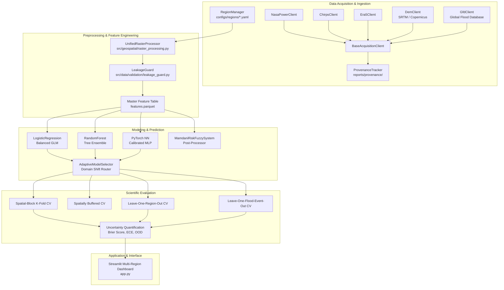

# GeoFlood-AI 2.0: System Architecture & Software Design

**Document Status:** Official Architecture Specification  
**Version:** 2.0 (Phase 2 Modular Multi-Regional Architecture)  
**Date:** November 2026  

---

## 1. Architectural Philosophy & Design Principles

GeoFlood-AI 2.0 departs from the monolithic, single-basin design of GeoFlood-AI v1. It implements a decoupled, research-grade architecture guided by five core principles:
1. **Basin-Agnostic Modularity:** No geographical coordinates, CRS projections, or event timestamps are hardcoded into model algorithms or evaluation scripts. All geographical context is injected dynamically via `RegionManager`.
2. **Strict Leakage Prevention:** The `LeakageGuard` subsystem audits feature pipelines and rejects post-event variables whenever operating in operational forecasting mode.
3. **Resilient Data Layer:** Acquisition clients (`BaseAcquisitionClient`) incorporate persistent disk caching, SHA-256 verification, and automatic fallback mechanisms.
4. **Metric Topographic Processing:** Terrain features (finite-difference slope, TPI, HAND relative elevation) are computed using regional projected metric coordinates (UTM projections), eliminating latitudinal distortion.
5. **Decoupled Application Layer:** The Streamlit interactive user interface is decoupled from model training, feature extraction, and validation routines, allowing headless execution, batch experimentation, and CI testing.

---

## 2. High-Level System Architecture



---

## 3. Package and Directory Structure

```
GeoFlood-AI/
├── configs/
│   └── regions/                     # Multi-region YAML specifications
│       ├── assam.yaml               # Brahmaputra Basin
│       ├── kerala.yaml              # Periyar-Pamba Catchments
│       ├── mahanadi.yaml            # Mahanadi Delta
│       └── godavari.yaml            # Lower Godavari Basin
├── config/
│   └── settings.yaml                # Global paths & backward-compatibility config
├── data/
│   ├── cache/                       # Cached raw API downloads (NASA, CHIRPS, ERA5, DEM)
│   ├── raw/                         # Extracted regional GeoTIFFs and DEM mosaics
│   ├── processed/                   # Region-specific master feature tables (Parquet)
│   └── sample/                      # Stratified offline test datasets
├── src/
│   ├── data/
│   │   ├── acquisition/             # Modular external data ingestion clients
│   │   │   ├── base_client.py       # Abstract client, retries, caching, validation
│   │   │   ├── nasa_power.py        # NASA POWER daily meteorology client
│   │   │   ├── chirps.py            # CHIRPS daily high-res precipitation client
│   │   │   ├── era5.py              # ERA5-Land reanalysis client via Open-Meteo
│   │   │   ├── dem_client.py        # Multi-source DEM mosaic client (SRTMGL1)
│   │   │   └── gfd_client.py        # Global Flood Database raster client
│   │   ├── provenance/
│   │   │   └── metadata_logger.py   # ProvenanceTracker & dataset catalog export
│   │   └── validation/
│   │       └── leakage_guard.py     # LeakageGuard, temporal cutoffs, mode validation
│   ├── geospatial/
│   │   ├── region_manager.py        # Central multi-region manager & coordinate validator
│   │   ├── raster_processing.py     # UnifiedRasterProcessor, metric slope, TPI, HAND
│   │   └── grid.py                  # Grid coordinates, spatial blocks, CRS utilities
│   ├── models/
│   │   ├── baselines.py             # Logistic Regression & Random Forest
│   │   ├── nn.py                    # PyTorch MLP with BatchNorm & Dropout
│   │   ├── fuzzy_layer.py           # Mamdani Fuzzy System
│   │   ├── train.py                 # Training pipeline & threshold tuning
│   │   └── predict.py               # GeoFloodPredictor inference engine
│   ├── evaluation/
│   │   ├── splits.py                # Spatial block, buffered, and event holdouts
│   │   ├── metrics.py               # Optimal thresholding, PR-AUC, Brier score
│   │   └── run_validation.py        # Phase 3 validation runner & figure generator
│   └── ui/
│       ├── styles.py                # Dark theme CSS, plot layout, color palettes
│       └── map_builder.py           # Pixel-accurate Folium raster overlays & landmarks
├── tests/
│   ├── test_geospatial_alignment.py # Raster alignment & Folium projection tests
│   ├── test_location_analysis.py    # Coordinate query & scenario engine tests
│   ├── test_model_comparison.py     # Multi-model inference & overlay tests
│   ├── test_phase2_architecture.py  # Phase 2 RegionManager, clients, guard & provenance tests
│   ├── test_pipeline.py             # Feature building, DEM imputation, block tests
│   └── test_scientific_validation.py# Spatial holdout, Platt calibration, Brier tests
└── docs/
    ├── RESEARCH_AUDIT.md            # Comprehensive codebase & gap audit
    ├── DATA_SOURCES.md              # Complete catalog of external data sources
    ├── SYSTEM_ARCHITECTURE.md       # Software architecture & component design
    └── RESEARCH_METHODOLOGY.md      # Scientific methodology & generalisation protocols
```

---

## 4. Subsystem Component Details

### 4.1 Geospatial Region Management (`src/geospatial/region_manager.py`)
* **Role:** Manages regional configurations and provides boundary checking.
* **Key Classes:**
  - `BoundingBox`: Implements coordinate validation, range enforcement $[-90, 90]$ and $[-180, 180]$, and point containment tests.
  - `RegionMetadata`: Encapsulates regional boundaries, river basin taxonomy, UTM metric CRS, grid resolution, and benchmark events.
  - `RegionManager`: Factory and registry that loads YAML configurations, validates coordinates, computes discrete grid dimensions, and calculates required SRTM tiles.

### 4.2 Unified Raster Preprocessing (`src/geospatial/raster_processing.py`)
* **Role:** Transforms heterogeneous raster assets onto a uniform master grid.
* **Key Class:**
  - `UnifiedRasterProcessor`: Resamples external GeoTIFFs using bilinear interpolation, calculates finite-difference slope in projected metric space, computes TPI via uniform moving filters, and estimates relative elevation (HAND proxy) using minimum moving filters.

### 4.3 Provenance and Quality Tracking (`src/data/provenance/metadata_logger.py`)
* **Role:** Records tamper-evident audit trails for every ingested and processed layer.
* **Key Classes:**
  - `DatasetProvenanceRecord`: Structured record with geographic bounds, timestamps, missing value percentages, and SHA-256 artifact hashes.
  - `ProvenanceTracker`: Serializes records as individual JSON files and exports an aggregated `provenance_catalog.json`.

### 4.4 Leakage Prevention Subsystem (`src/data/validation/leakage_guard.py`)
* **Role:** Protects the experimental framework against temporal information bleeding.
* **Key Classes:**
  - `ModelingMode`: Supports `PRE_EVENT_FORECASTING`, `RETROSPECTIVE_SUSCEPTIBILITY`, and `EVENT_BASED_ANALYSIS`.
  - `LeakageGuard`: Validates feature sets against the active modeling mode. Automatically rejects `rain_event_sum` during forecasting mode and computes explicit pre-event cutoff dates.
